# Card 5a2: size sweep, test set, environment 4a65fc26

Reference predictors: test MSE minus the toy's floor, against the expected excess (0 for the oracle; offset^2 for the planted offset; (1 - factor)^2 x mean(m(x)^2) for the planted scale), with the standard error of the MSE from the draw's label noise. A difference of more than a few standard errors means the generator, the stated true mean or the floor is wrong.

(no reference predictors in this plan)

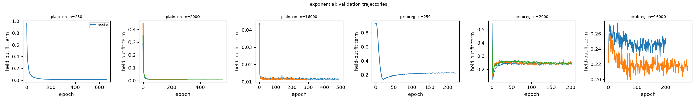
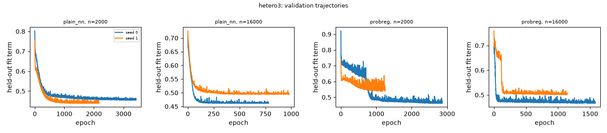
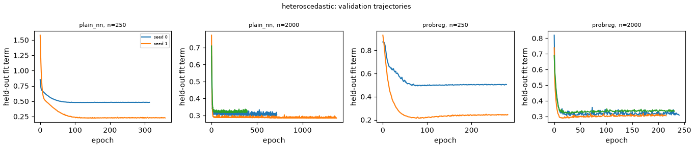
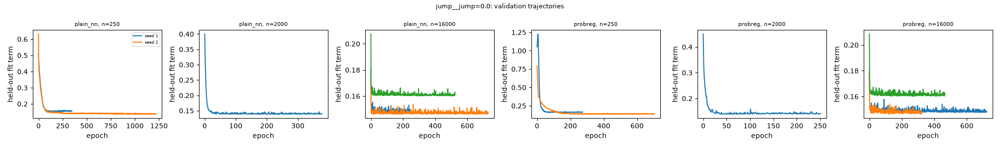
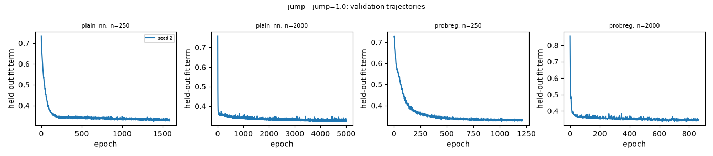
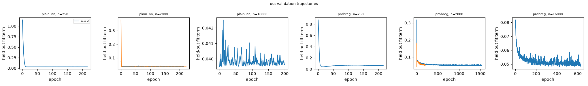
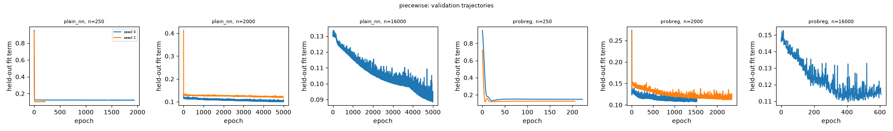
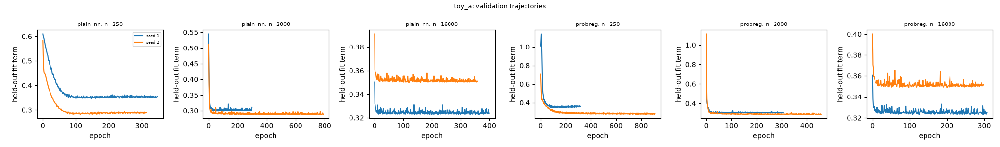
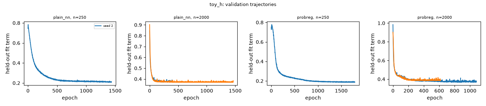
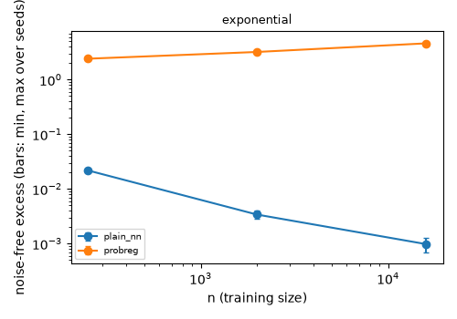
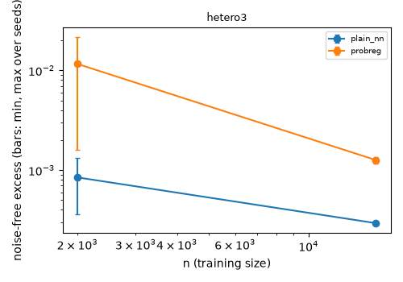
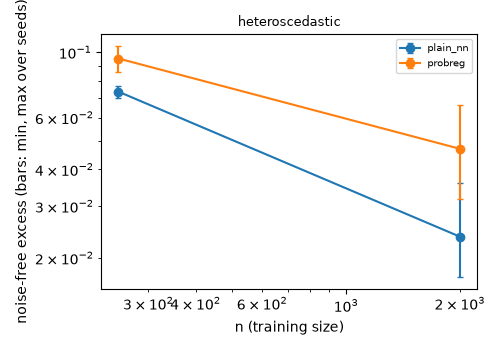
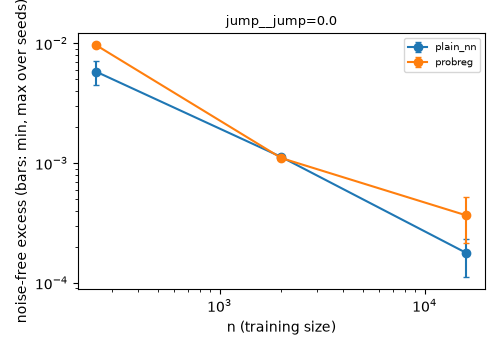
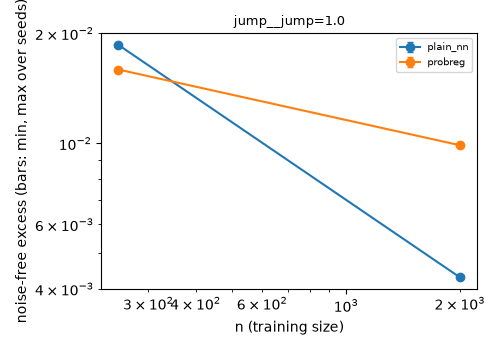
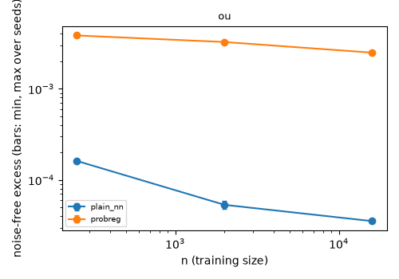
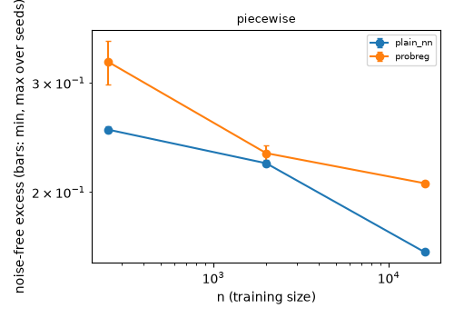
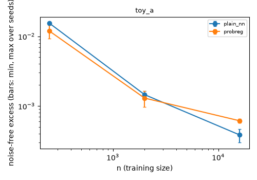
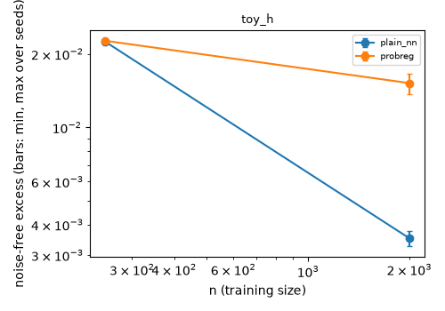
